<p align="center">
  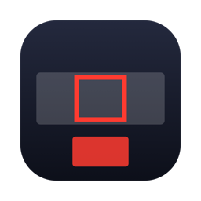
</p>

<h1 align="center">FrameShare</h1>

<p align="center">
  <b>Share just part of your big screen in Zoom, Google Meet, Teams, Slack, or any app that can share a window.</b><br>
  A free, open-source macOS menu bar app by Anton Pushkin.
</p>

<p align="center">
  <a href="https://github.com/pushkinman/FrameShare/releases/latest"></a>
  
  
  <a href="LICENSE"></a>
</p>

<p align="center">
  <a href="https://github.com/pushkinman/FrameShare/releases/latest"><b>⬇ Download the latest version</b></a>
  &nbsp;·&nbsp; <a href="#install">Install</a>
  &nbsp;·&nbsp; <a href="#features">Features</a>
  &nbsp;·&nbsp; <a href="#build-from-source">Build from source</a>
</p>

<p align="center">
  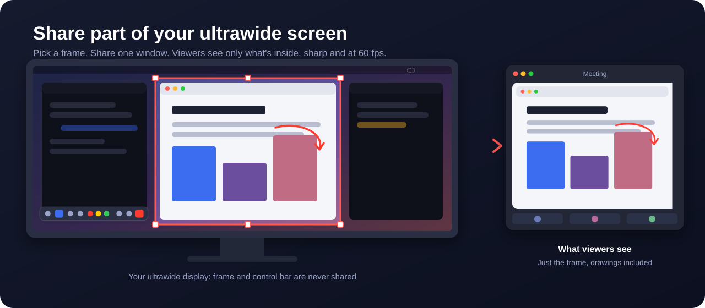
</p>

## Why

Sharing an entire ultrawide or 4K display makes everything tiny for viewers. Sharing a single window means switching what you share every time you move to another app.

FrameShare gives you a **movable frame** on your screen. Whatever is inside it, from any app or several apps, goes into one window that you share in your meeting. Move the frame, resize it, snap it to a window, or draw on it. Viewers always see a sharp, full-resolution picture at up to 60 fps.

## Install

1. Download **`FrameShare-1.0.dmg`** from the [latest release](https://github.com/pushkinman/FrameShare/releases/latest).
2. Open it and drag **FrameShare** onto **Applications**.
3. FrameShare isn't notarized by Apple (it's a free hobby project), so macOS will warn you the first time. Pick **one** of these:
   - **System Settings:** try to open FrameShare, click **Done**, then go to **System Settings → Privacy & Security**, scroll down, and click **Open Anyway** next to FrameShare.
   - **Terminal:** run this once, then open the app normally:
     ```bash
     xattr -dr com.apple.quarantine /Applications/FrameShare.app
     ```
4. Click the dashed-rectangle icon in the menu bar → **Start Sharing**, allow **Screen Recording** when asked, then quit and reopen FrameShare.

Needs macOS 14 Sonoma or newer. One download runs on Apple Silicon and Intel Macs.

> Prefer not to run an unsigned download? [Build it yourself](#build-from-source). It takes a minute and needs only Apple's free Command Line Tools.

## How to use

1. **Start sharing** from the menu bar icon or press **⌃⌥S**. A red frame appears on your screen.
2. **Position the frame:** drag its edge to move it, and its handles to resize it. You can also type an exact size, use Left / Center / Right, snap to the left or right half, or match the frame to the active window.
3. In your meeting app, **share the window named "FrameShare"**, not your whole screen.
4. Use the **floating control bar** to draw, spotlight, zoom, and more. Viewers never see the bar, the frame border, or the dimming.

The "FrameShare" window is hidden from you by default: it sits just past the corner of your display, where meeting apps can still share it at full quality. If you'd like to see it, turn it on in **Settings → General → Shared window**.

## See it in action

<p align="center">
  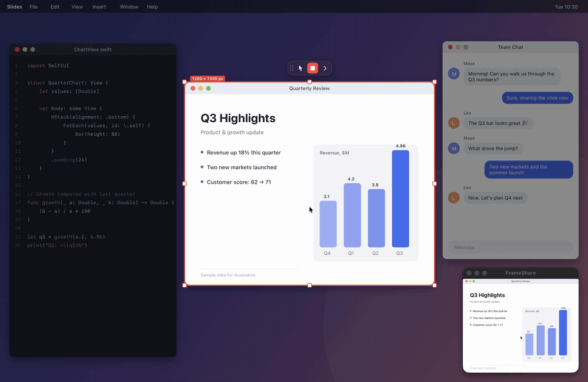
</p>
<p align="center"><sub>Move or resize the frame and the shared window follows instantly. Everything outside the frame is dimmed for you, and viewers never see the frame itself.</sub></p>

## Features

### Frame

- Aspect ratios: 16:9, 16:10, 4:3, 3:2, 1:1, 21:9, 9:16, or free
- Exact width, height and position; Left / Center / Right; full height; left or right half of the screen
- Frame → active window, and active window → frame, aligned pixel for pixel
- Dim everything outside the frame; border color, thickness, opacity and padding; lock the frame

### Draw on anything you share

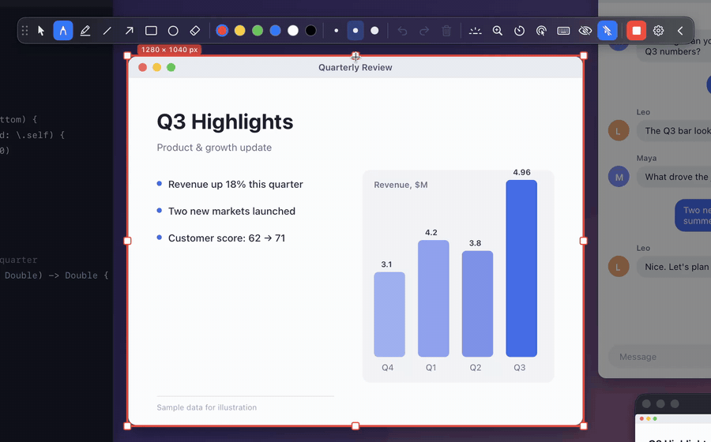

- Pen, highlighter, line, arrow, rectangle, ellipse and eraser
- Six colors and three line widths; undo ⌘Z, redo ⇧⌘Z, clear
- Hold Shift for straight lines; optional auto-fade; Esc goes back to the mouse

### Floating control bar

All the presenter tools in one bar that stays on your screen but never in the shared picture. Collapse it, drag it anywhere, or turn it vertical.

<p align="center">
  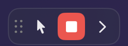
  &nbsp;&nbsp;
  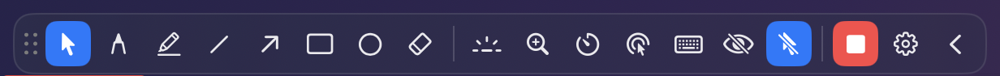
</p>
<p align="center">
  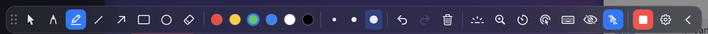
</p>

### Spotlight and zoom

<table>
  <tr>
    <td width="50%">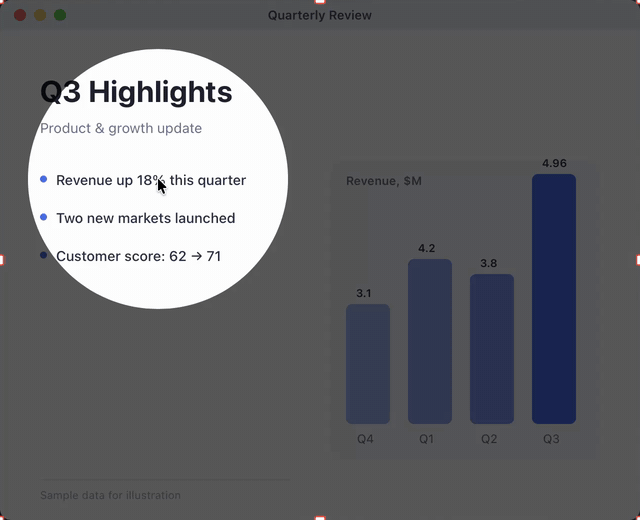</td>
    <td width="50%">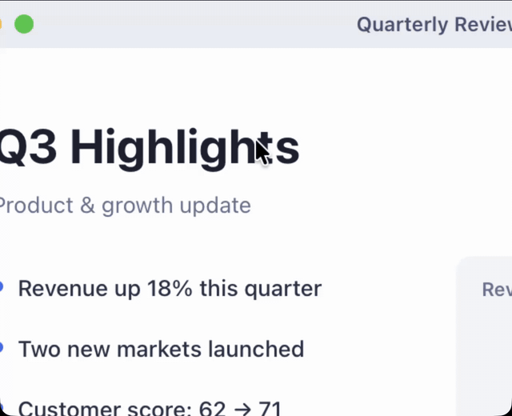</td>
  </tr>
  <tr>
    <td align="center"><sub><b>Spotlight</b> follows your cursor and dims the rest</sub></td>
    <td align="center"><sub><b>Zoom</b> follows your cursor (what viewers see)</sub></td>
  </tr>
</table>

### Timer, keystrokes and click rings

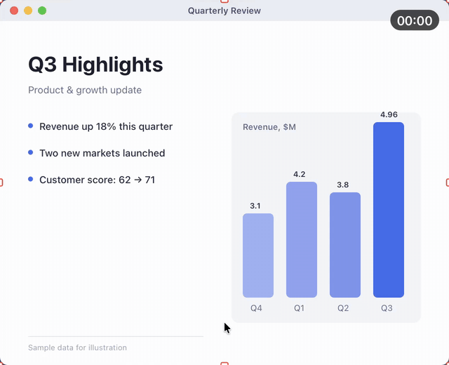

- Stopwatch or countdown in any corner
- Shows the shortcuts and text you type
- Rings show viewers where you click: yellow for left, blue for right

### Privacy

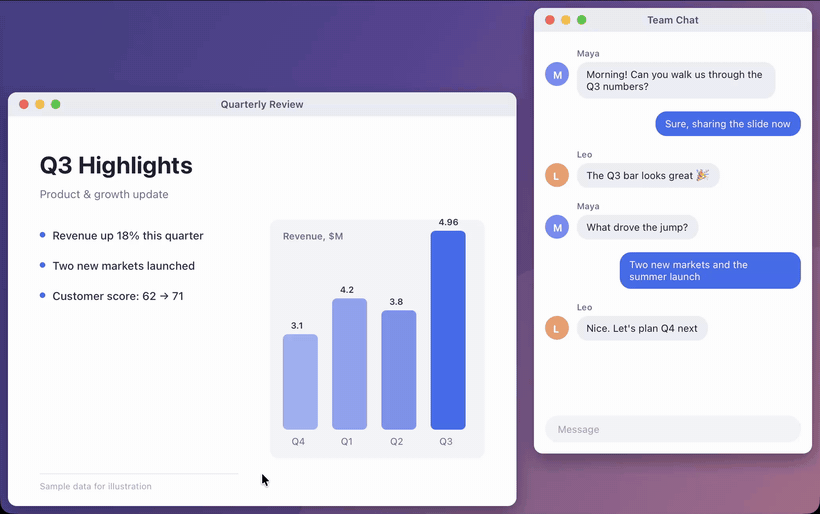

- Hide chosen apps from the shared picture completely, or blur them
- Blur windows or browser tabs by title keyword or URL
- One-click "blur everything"
- Hide the mouse cursor from viewers

### Menu and settings

<table>
  <tr>
    <td width="42%">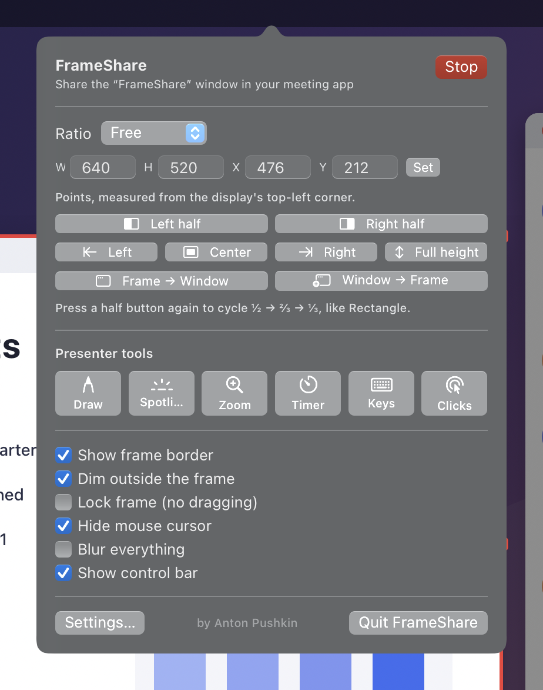</td>
    <td width="58%">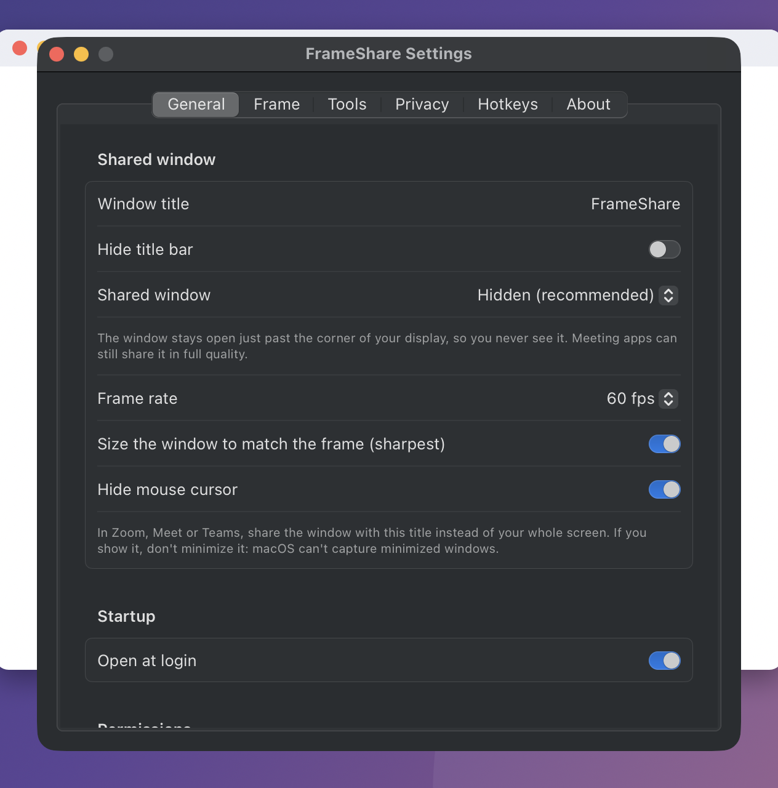</td>
  </tr>
</table>

- Global hotkeys for every action, all customizable
- Native resolution, up to 120 fps, pixel-exact output
- Open at login

<sub>All clips were recorded with FrameShare itself on a demo desktop with made-up content.</sub>

### Default hotkeys

| Action | Keys |
|---|---|
| Start / stop sharing | ⌃⌥S |
| Draw / back to the mouse | ⌃⌥D |
| Clear drawings | ⌃⌥C |
| Spotlight · Zoom · Timer | ⌃⌥L · ⌃⌥Z · ⌃⌥T |
| Keystrokes · Click rings | ⌃⌥K · ⌃⌥M |
| Blur everything | ⌃⌥B |
| Frame → active window | ⌃⌥W |
| Show / hide control bar | ⌃⌥G |
| Left / right half | ⌃⌥⇧← · ⌃⌥⇧→ |
| Frame left · center · right | ⌃⌥⌘ + ← · ↓ · → |

Hide cursor and active window → frame have no default shortcut; set one in **Settings → Hotkeys**.

## Permissions

| Permission | Needed for |
|---|---|
| Screen Recording | Always. This is how the frame's contents are captured |
| Accessibility | Only for snapping the frame to windows and resizing windows |
| Input Monitoring | Only for showing keystrokes |
| Automation | Only for blurring browser tabs by URL |

FrameShare has no network code. Nothing you share is ever sent anywhere except through the meeting app you choose.

## Build from source

Requires macOS 14+ and the Xcode Command Line Tools (`xcode-select --install`). Full Xcode isn't needed.

```bash
git clone https://github.com/pushkinman/FrameShare.git
cd FrameShare
./scripts/setup_signing.sh        # optional, one time: keeps permissions across rebuilds
./scripts/build_app.sh --install  # builds, installs to ~/Applications and opens it
```

Without `setup_signing.sh`, the app is ad-hoc signed and macOS may ask for Screen Recording permission again after each rebuild.

`./scripts/make_dmg.sh` builds a universal (Apple Silicon + Intel) app and packs it into `build/FrameShare-1.0.dmg`.

<details>
<summary><b>Troubleshooting</b></summary>

**"The user declined TCCs" or capture keeps failing:** reset the permission and grant it again:

```bash
tccutil reset ScreenCapture local.frameshare.app
```

Then start sharing, click Allow, and quit and reopen FrameShare.

**Checking quality:** quit FrameShare, then run:

```bash
open -n ~/Applications/FrameShare.app --args --selftest
```

This shares for about 3 seconds, captures the shared window the way a meeting app does, and compares it pixel by pixel with the screen. The report is saved to `~/Library/Caches/FrameShare-selftest/`. `--selftest-hidden` checks the hidden shared window, and `--selftest-snap` checks window snapping.

**Re-recording the demo clips:** `--record-demo` covers the screen with a made-up desktop, records only FrameShare's own windows, and saves the clips to `~/Library/Caches/FrameShare-demo/`. It doesn't change your saved settings.

</details>

<details>
<summary><b>Code map</b></summary>

| Folder | What's inside |
|---|---|
| `Sources/FrameShare/Capture` | ScreenCaptureKit stream, Core Image blur and zoom |
| `Output` | The shared window |
| `Region` | Frame, handles, dimming, geometry |
| `Tools` | Drawing, spotlight, timer, keystrokes, click rings, control bar |
| `Privacy` | Blur tracking |
| `Snap` | Window snapping via Accessibility |
| `Hotkeys` | Global shortcuts |
| `App/AppController.swift` | Ties everything together |

</details>

## License

[MIT](LICENSE) © 2026 Anton Pushkin.

FrameShare is an independent project and isn't affiliated with Apple, Zoom, Google, Microsoft or Slack.
